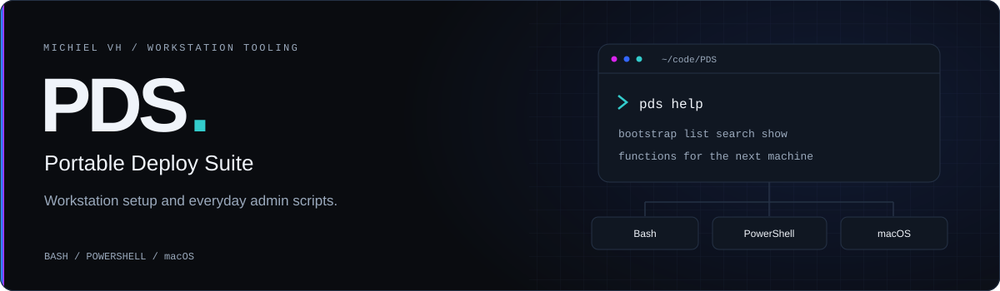

<picture>
  <source media="(prefers-color-scheme: light)" srcset="docs/assets/pds-banner-light.svg">
  
</picture>

# Portable Deploy Suite

The scripts I use to set up my machines and handle the admin work that comes after. Software installs, shell configuration, cloud tooling, and Windows administration, collected in one place.

PDS has Bash functions for Linux, a PowerShell module for Windows, and Homebrew setup scripts for macOS. Each platform has its own entry points and coverage.

[Bash](bash/readme.md) · [PowerShell](pwsh/readme.md) · [macOS](darwin/readme.md) · [Issues](https://github.com/michielvha/PDS/issues)

## Platform coverage

| Platform | What is here | Where to start |
| --- | --- | --- |
| Debian / Ubuntu | Staged workstation bootstrap, software and shell functions, `.deb` packaging, and the `pds` CLI | [Bootstrap guide](docs/workstation-bootstrap.md) |
| Fedora | Software installers and a separate system bootstrap script. The staged workstation bootstrap is Debian-only. | [Fedora scripts](bash/fedora/) |
| Arch Linux | Setup and virtualisation scripts. No staged workstation bootstrap. | [Arch scripts](bash/arch/) |
| Windows | PowerShell functions for software, shells, cloud and Kubernetes tools, diagnostics, and administration | [PowerShell module](pwsh/module/) |
| macOS | Homebrew installation and shell setup scripts | [macOS guide](darwin/readme.md) |

The Debian bootstrap still needs a full run on a real Linux host. [Issue #32](https://github.com/michielvha/PDS/issues/32) tracks installation, credential storage, and package validation. Existing scripts do not establish equivalent coverage across platforms.

## Get started

Clone the repository to inspect the scripts and use the functions you need:

```bash
git clone https://github.com/michielvha/PDS.git
cd PDS
```

### Linux

For a fresh Debian or Ubuntu workstation, load the bootstrap functions from your checkout:

```bash
source bash/debian/deploy/bootstrap.sh
bootstrap_workstation repos
```

The `repos` stage needs GitHub CLI authentication. Other stages install the base system tools, the development stack, and GitHub authentication tooling. Run `bootstrap_workstation` without a stage to run them all.

Review the [bootstrap guide](docs/workstation-bootstrap.md) before running the full setup. The `base` stage upgrades the system, enables passwordless sudo, and replaces the user's Zsh configuration. Installer functions may fetch additional scripts from GitHub.

If the `.deb` package is already installed:

```bash
pds help
pds list
pds search docker
pds show install_docker
pds bootstrap repos
```

See [packaging](packaging/README.md) for the build and installation instructions.

### Windows

Import the PowerShell module from your checkout:

```powershell
Import-Module .\pwsh\module\PDS.psm1
Get-Command -Module PDS
```

Use [the function documentation](pwsh/docs/readme.md) and [module source](pwsh/module/Public/) to choose what to run. The [Windows setup script](pwsh/scripts/main.ps1) makes system changes and installs a personal selection of applications.

### macOS

Read the [macOS guide](darwin/readme.md) and review [the installer](darwin/install.sh) for its Homebrew packages and shell changes before running it.

## Find your way around

| Path | Contents |
| --- | --- |
| [`bash/common/`](bash/common/) | Shared shell, Git, cloud, and software functions |
| [`bash/debian/`](bash/debian/) | Debian and Ubuntu installers, desktop setup, and workstation bootstrap |
| [`bash/fedora/`](bash/fedora/) · [`bash/arch/`](bash/arch/) | Distribution-specific scripts |
| [`pwsh/module/Public/`](pwsh/module/Public/) | PowerShell functions grouped by purpose |
| [`pwsh/docs/`](pwsh/docs/) | PowerShell function reference |
| [`darwin/`](darwin/) | macOS installation and shell configuration |
| [`packaging/`](packaging/) | Debian package, CLI, and container configuration |
| [`docs/`](docs/) | Setup guides |

## Development

[AGENTS.md](AGENTS.md) pins the shared engineering conventions used with vh-adlc. Read it before changing the scripts. A new feature gets a feature document with acceptance criteria and a test plan; its issue tracks the work.

The APT workflow includes ShellCheck and package installation checks. PowerShell validation and broader bootstrap coverage still need work. See the [open issues](https://github.com/michielvha/PDS/issues) for the backlog.

## References

[PowerShell Gallery](https://www.powershellgallery.com/) · [Tiny11Builder](https://github.com/ntdevlabs/tiny11builder) · [Win11Debloat](https://github.com/Raphire/Win11Debloat) · [Crapfixer](https://github.com/builtbybel/Crapfixer)

## License

[GPL-3.0](LICENSE).
